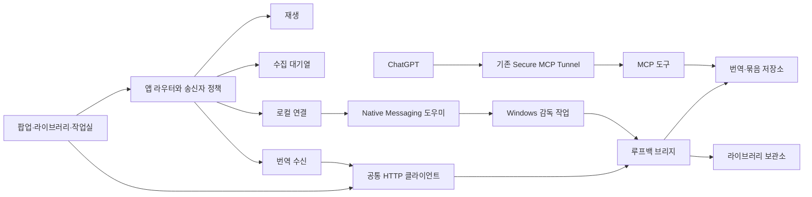

# OTTDeck 모듈 구조

OTTDeck은 재생·자막·수집·번역·개인 라이브러리를 연결하는 도구다. Chrome 확장, 로컬 서버, 모델 실행기는 별도 실행 경계를 가지며 기능 추가가 기존 저장 형식이나 연결 식별자를 바꾸지 않도록 구성한다.

## 책임과 의존 방향

| 경로 | 책임 |
|---|---|
| `shared/product.js` | 제품 표시명과 동결된 호환 식별자. 개인 계정·키는 포함하지 않음 |
| `shared/extension-assets.mjs` | 확장 배포에 포함할 공개 파일의 명시적 목록 |
| `modules/app/` | 기능 조립, 메시지 라우팅, 공통 송신자 정책 |
| `modules/playback/background.js` | 재생 탭의 상태·아이콘·저장 세션 전달 |
| `modules/capture/background.js` | 수집 대기열 작업의 등록과 접근 정책 |
| `modules/translation/background.js` | 번역 준비·수신·진행 조회의 등록과 접근 정책 |
| `modules/translation/job-store.mjs` | 고정 요청·분할·전편 확정·진행의 영속 저장 |
| `modules/translation/batch-store.mjs` | 회차별 고정 작업의 순서·묶음 관리 |
| `modules/translation/mcp-server.mjs` | 기존 다섯 MCP 도구의 계약과 감사 기록 |
| `modules/library/archive.mjs` | 검증된 보관 원문·완료 번역의 읽기 전용 공개 |
| `modules/runtime/bridge-http.js` | 팝업·작업실·라이브러리·수신 워커의 공통 HTTP 클라이언트 |
| `modules/runtime/bridge-server.mjs` | 루프백 API·MCP 전송·페어링·서버 조립 |
| `modules/runtime/http-policy.mjs` | 요청 크기·JSON 파싱·상수 시간 토큰 비교 |
| `modules/runtime/background.js` | 관리 화면에서만 허용하는 로컬 시작·상태 조회 |
| `subtitles/` | 자막 파서·계약·화면 표시·IndexedDB·수집/수신 엔진과 기존 UI 진입점 |
| `popup/` | 사용자가 누르는 재생·번역·연결 UI |
| `scripts/` | CLI·Windows 설치/기동 어댑터 및 기존 공개 import 호환 계층 |
| `scripts/runtime/config.ps1` | 기존 개인 프로필에서 터널·조직 식별자 조회. 키를 복호화하거나 실행하지 않음 |
| `native/` | Chrome 프레임 프로토콜로 고정된 시작·상태 명령만 처리하는 Windows 도우미 |

`scripts/background.js`는 고정 진입점에서 의존 모듈을 불러오고 조립만 한다. 기능 모듈은 공통 라우터에 액션·송신자 정책·입력 조건·실행 함수를 등록한다. 같은 액션의 중복 등록은 오류다. 송신자 검사는 입력 검사와 실행보다 먼저 수행한다. 외부 웹페이지는 로컬 프로세스 시작 경로에 접근할 수 없다.

HTTP 클라이언트는 목적지를 루프백으로 고정하고 인증 헤더·JSON·제한 시간·오류 처리를 한 곳에서 관리한다. 각 화면은 UI와 업무 흐름만 담당한다. 워커는 GET만 사용한다. 서버의 페어링·저장·모델 실행 경계는 그대로 유지한다.

## 기능을 추가할 때

1. 해당 영역에 동작을 구현한다. DOM·Chrome API·로컬 서버 코드가 서로 의존하지 않도록 어댑터를 구분한다.
2. 백그라운드 액션이 필요하면 공통 라우터에 송신자 정책과 입력 조건을 함께 등록한다. `modules/app/background.js`에서 기능을 조립한다.
3. 브라우저 파일이면 `shared/extension-assets.mjs`에 추가하고 필요한 진입점에서 명시적으로 로드한다. 호스트 전용 코드를 확장에 통째로 포함하지 않는다.
4. 실제 위험을 확인하는 경계 검사를 추가한다. 원문·요청 해시, 다른 회차 적용 차단, 충돌·재시작·인증은 기존 검사를 유지한다.
5. 표시명 변경과 저장·통신 형식 변경을 구분한다. [호환 정책](COMPATIBILITY.md)을 확인한다.

동적 원격 플러그인이나 자동 코드 다운로드는 사용하지 않는다. 새 도구 추가에 불필요한 권한을 미리 부여하지 않는다. 현재 파서·오버레이·IndexedDB 엔진의 진입점은 유지하며 기능별 인터페이스를 통해 점진적으로 확장한다.

## 검사

`npm test`는 기능·계약·접근 경계를, `npm run check`는 문법·manifest·HTML·worker의 배포 의존성을 검사한다. `npm run package`는 허용된 파일만 `dist/OTTDeck-<version>`에 만든다. `npm run test:browser`는 기존 계정과 분리한 합성 미디어에서 Chromium 확장을 검사한다. 실제 Netflix 싱크·의미 품질·ChatGPT 대화 성공은 별도 증거가 필요하다.
