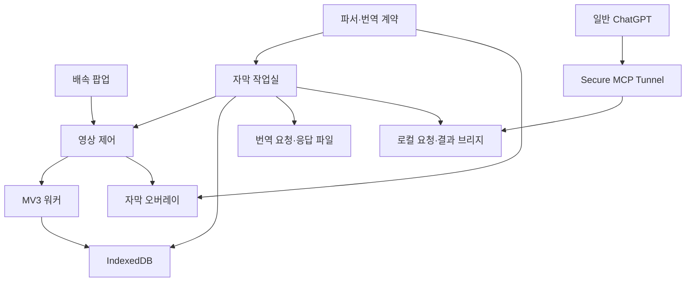

# OTTDeck 프로젝트 설계

현재 제품·저장소 이름은 **OTTDeck / ottdeck**이다. 기존 OTTSpeed의 연결·저장 형식은 유지한다. 최신 코드 책임과 기능 추가 절차는 [모듈 구조](ARCHITECTURE.md), 이름 변경과 기존 설치 갱신은 [호환 정책](COMPATIBILITY.md)을 따른다. 아래 초기 설계·검증 기록은 당시 범위를 설명한다.

## 목적과 이번 결정

배속 조절 확장인 OTTSpeedController에 고품질 자막 사용·교정·번역을 통합한다. 별도 제품·저장소를 만들지 않는다. 이전 자막 프로젝트 가칭 SceneBridge의 설계는 OTTSpeed의 자막·번역 모듈 방향으로 이어간다.

첫 단계는 사용자가 선택한 파일을 이용한 수동 왕복이다. 자동 번역의 성능을 논하기 전에 **좋은 번역 파일을 넣었을 때 실제 영상에 정확하고 읽기 편하게 표시되는지**를 확인한다. 원문·한국어·번역 결과의 ID와 시간을 보존해 이후 로컬/클라우드 엔진을 같은 계약에 연결한다.

2026-10-23 후속 구현은 [Netflix 전체 파일 수집](NETFLIX_CAPTURE.md)과 [일반 ChatGPT MCP 브리지](CHATGPT_MCP.md)다. 새 Netflix 경로는 기존 수동 흐름과 구분하며 `reference=null`, 수집한 영어의 ID·시각 전량, 보정 0/1을 사용한다. 브리지는 번역을 생성하지 않고 일반 ChatGPT의 부분 결과를 검증·보관·병합한다. 2026-10-24부터 앞에서부터 준비된 범위는 전편 확정 전에도 B로 수신하며, 팝업의 프롬프트 복사·처음부터 B 재생 경로를 제공한다. 아래 목표에는 자막 라이브러리·시즌 사전 준비·공식 ChatGPT 연계 조사를 포함한다. 조사 항목은 구현·실사용 확인 완료와 구분한다.

최신 후속 구현은 [Netflix 백그라운드 수집 대기열](BACKGROUND_COLLECTION.md)이다. 명시한 회차 목록으로 사용자 탭 조작 없는 Chrome 수집을 구현하고 합성 검사했다. 실제 Netflix 비활성 탭 성공은 미확인이고 브라우저 자체가 없는 새 수집·시즌 주소 자동 발견은 미구현이다. 아래의 이전 연구 상태보다 이 후속 상태를 우선한다.

초기 빈 프로필 시험 뒤 사용자 승인으로 전용 프로필에 정상 로그인했다. 후속 [인증된 headless 수집](HEADLESS_CAPTURE.md)에서 E03 1,831개·E04 1,867개 영어 CC 전체 파일 확보와 독립 검사에 실제 성공했다. 이 별도 실행 도구와 일반 Chrome 비활성 탭 대기열을 구분한다. 비활성 탭 최초 로드, 팝업과 headless 실행 연결, 시즌 회차 자동 발견은 아직 확인/구현되지 않았다.

추가 [동시 시청 시험](CONCURRENT_HEADLESS_CAPTURE.md)에서는 사용자의 E05 1.25배속 재생 중 E06 2,236개 영어 전편 확보·독립 검사를 확인했다. 전·중·후 표본에서 기존 재생이 유지됐고 실제 영상 시계 진행도 배속과 일치했다. 이 단일 성공을 무제한 병렬 수집으로 확대하지 않는다.

## 기존 저장소 검토

검토 기준: upstream master `29d8873ec5a0371e1414debca1398fd3630cb3a0`.

| 발견 | 변경 |
|---|---|
| 작은 순수 JavaScript MV3 확장, 빌드 도구 없음 | 기존 구조·설치 방식을 유지하고 독립 모듈 추가 |
| 제거된 video 이벤트와 참조가 남음 | 분리 시 정리, 새 영상 감지·속도 승계 |
| 입력 중 단축키가 작동 | composedPath에서 편집 요소와 IME 검사 |
| 속도 값 검증 부족 | 유한 숫자, 0.25–4 범위 검사 |
| 팝업이 다른 탭 상태 메시지를 받음 | sender extension/tab 확인 |
| worker 메모리의 탭 상태가 영속 상태처럼 취급될 수 있음 | 아이콘 Map은 캐시, 자막은 IndexedDB에 저장 |
| body에 붙인 UI의 전체화면 한계 | 플레이어 컨테이너에 재배치, video 자체 전체화면은 명시적으로 한계 표시 |
| 자동 테스트 없음 | 자막 계약·재생 상태·Chrome API 경계 회귀 테스트와 실제 브라우저 smoke harness 추가 |

## 모듈 경계

기존 속도 저장 키 `speed`는 유지한다. 자막에는 별도 IndexedDB `ottspeed-subtitles/sessions`를 사용한다. 워커가 종료돼도 파일과 설정이 보존되며 새 콘텐츠 스크립트가 저장 세션을 요청한다. 영상 교체와 비동기 복원의 경쟁은 세대 번호로 제어한다. 잘못된 수동 세션이 정상 세션을 부분 교체하지 않는다. 여러 작업실의 동시 편집은 readwrite transaction 안에서 revision 토큰을 비교해 오래된 전체 세션의 덮어쓰기를 거부한다. 저장 성공 후 영상 전달에 실패해도 저장된 새 데이터를 유지하고 재적용한다.

사이트 식별은 현재 Netflix watch ID와 YouTube video ID에 한정해 안정된 키를 사용한다. generic 페이지는 임시 문서 UUID·video 번호·소스 세대를 붙인다. 로컬 경로나 URL의 인증정보·추적 쿼리는 번역 파일에 포함하지 않는다. 사용자가 고른 자막이 실제 그 회차인지는 자동으로 보증하지 않는다.

## 번역 계약

요청은 `kind: ottspeed.translation-request`, `schemaVersion: 1`이다. `requestId`는 작업을 식별하고 `sourceHash`는 영상·모드·원문·참고 자막·출력 슬롯의 ID/시간/텍스트 전체를 SHA-256으로 묶는다. `mediaKey`는 표시 대상 영상을 구분한다.

- `source`: 영어 원문 전체 cue.
- `reference`: 교정 모드에서 선택한 한국어 cue. 새 번역에서는 한글 A가 있으면 포함하고 없으면 null.
- `slots`: 기본값은 새 번역의 영어 cue, 교정의 한국어 cue다. 파일 준비 스크립트는 `outputSlots`로 원문 근거가 있는 보충 구간을 요청 생성 전에 확정할 수 있다. 보충 근거와 미확인 범위는 별도 기록하며 slots 전체를 해시에 포함한다.
- `instructions`: 문맥·용어·인물 관계·자막 압축·데이터 취급 지시.
- `outputTemplate`: 필수 메타데이터와 모든 cue ID를 포함한 응답 틀.

응답은 `kind: ottspeed.translation-response`이며 필수 메타데이터를 그대로 돌려준다. `cues`에는 `{id, text}`를 반환한다. 누락·중복·추가 ID, 빈 대사, 다른 원문·요청·영상, 시간을 바꾸려는 결과를 거부한다. 표시용 시작/종료 시간은 신뢰한 요청 슬롯에서 복원한다. 해시는 작업 혼동을 막기 위한 식별 장치이며 AI 번역의 의미 정확성을 판정하는 점수가 아니다.

기존 A는 수정하지 않고 결과를 B에 적용한다. 현재 B를 교체할 때 이전 문안과 요청 근거는 라이브러리 버전으로 보관한다. 한 요청의 연속적인 부분 결과는 하나의 번역 버전으로 취급한다. 교정 B는 선택한 한국어 트랙의 시간 보정을, 새 번역 B는 영어 트랙의 시간 보정을 요청 시점에 복사한다. 사용자가 실제 재생으로 확인하기 전에는 `timingVerified: false`다.

## 자막 품질의 핵심

정치 드라마의 번역 품질은 단문 번역 점수만으로 판단하지 않는다. 문맥상 지시 대상, 제도·법률 용어, 설득과 반어, 인물 간 관계, 앞뒤 농담, 화면에서 읽을 수 있는 길이를 확인한다. 보유 번역을 정답으로 간주하지 않고 잘된 표현은 유지하고 문제 구간을 교정한다.

영어와 한국어의 자막 수가 다른 자료를 번호로 결합하지 않는다. 이번 수동 요청에서는 각 언어의 전체 문맥을 제공하고 출력 슬롯을 고정한다. 향후 번역 메모리나 파인튜닝을 만들 때는 별도의 **다대다 문장 대응과 사람의 검토**가 필요하다.

## 단계별 다음 작업

2026-10-24 후속 지시로 **Workspace Agents 실계정 적용과 설치된 ChatGPT 확장 식별은 보류**하고, 개인 Pro에서 가능한 복사+MCP 범위를 계속한다. 이 두 항목은 현재 개발 단계의 차단 조건에서 제외하며 어댑터와 조사 기록은 보존한다. 라이브러리·버전·검사·검색·미리보기·내보내기·백업/복원과 수집된 회차의 묶음 준비·회차별 진행·수신 재개를 구현했고 전체 135개 자동 검사와 패키징을 통과했다. 새로운 회차 수집 경로의 실제 지원, 설치 확장 실행, 음성·영상·의미 검증은 별도로 확인할 후속 범위다.

### 다음 제품 목표와 진행 순서 (2026-10-24)

**볼 회차나 시즌의 자막을 미리 준비하고, 수집한 영어와 대응 한국어를 한곳에서 관리하며, 준비된 번역부터 시청하고 중단된 작업은 이어받는 개인용 번역·시청 제품으로 완성한다.**

현재 확정한 흐름은 `번역 시작 → 현재 회차 준비·프롬프트 복사 → 일반 ChatGPT에 한 번 전달 → 첫 구간 B 시청 → 후속 분할 수신·전편 확정 → 다음 시청 때 복원`이다. 다음 단계에서 `자막 라이브러리 → 회차/시즌 선택 → 수집 가능 여부 확인 → 선택한 원문의 일괄 번역 준비`로 진입점을 넓힌다. ChatGPT 공개 화면 자동 조작은 도입하지 않으며 공식 확장·연결 인터페이스의 활용 가능성을 조사한다.

아래는 큰 목표와 완료 기준이다. 2026-10-24에 실제 `/goal`로 등록했고, 관리 페이지·버전·백업/복원·수집된 원문의 묶음 준비·공식 Agent 어댑터를 구현했다. 로컬 자동 검사 125개와 독립 브라우저의 실제 IndexedDB 검사는 통과했다. 설치된 확장의 새 UI 실행과 실계정 Agent 왕복은 완료로 표시하지 않는다. 사용 범위와 상태는 [라이브러리 문서](SUBTITLE_LIBRARY.md)에 기록한다.

| 우선순위·큰 목표 | 사용자 없이 개발할 범위 | 개발 완료를 판단할 근거 |
|---|---|---|
| 1 · 영어·한국어 자막 라이브러리 | 작품·시즌·회차별 원문, 기존 한글 A, 번역 B와 버전을 조회하는 관리 페이지. 검색·필터·미리보기·검사 상태·원문과 번역의 연결·내보내기·백업. 재생 탭 없이도 저장 자료를 목록으로 확인하는 데이터 계층 | 같은 회차의 서로 다른 원문/번역 버전을 구분. 누락·부분 번역·완료·연결 미확인 상태를 표시. 회차명이나 cue 개수만으로 잘못 연결하지 않음. 합성 자료로 목록·연결·복원을 검사 |
| 2 · 중단돼도 복구되는 번역 작업 | 원문 준비·요청 전달 대기·번역 진행·시청 가능·전편 확정·연결 오류를 구분하는 상태 모델. 중복 시작 방지, 프롬프트 재복사, 제한된 간격의 재시도와 오류별 복구. 브리지·워커 재시작, 저장 뒤 영상 전달 실패, 동시 편집 충돌 처리 | 장애를 단계별로 주입해도 원문/A/수신한 B가 보존되고 재시작 후 이어짐. 전편 검증 뒤에만 완료 표시. 다른 회차에는 결과가 적용되지 않고 도착한 결과가 재생 위치·배속을 바꾸지 않음 |
| 3 · 회차·시즌 사전 준비 | 수집된 원문을 회차/시즌 단위로 선택해 고정 작업 묶음·진행·재개를 관리. 미수집 회차는 수집 대기로 구분. Chrome을 직접 조작하지 않는 수집과 완전히 브라우저 없는 수집의 가능성을 별도로 조사 | 로컬 합성 시즌에서 이미 완료한 작업 재사용·일부 누락·중단 재개·회차별 해시/진행 분리를 검사. 새 Netflix 원문 확보는 실제 해당 수집 경로를 입증할 때만 지원으로 표시 |
| 4 · 회차 사이에 일관된 번역 품질을 관리 | 인명·호칭·용어집과 근거·허용 회차 범위를 갖춘 문맥 기록. 자동 후보와 확정 기록을 구분하고 요청에 버전을 고정. 짧은 슬롯·읽기 속도·동일시각/중첩 발화 검사. ID와 원래 시각·사유를 묶은 부분 교정 요청과 이력 | 합성 자료에서 스포일러 범위 초과·빈 문안·ID 누락·동시 발화 손실을 탐지. ID/시각을 유지한 부분 교정 왕복 검증. 검사 통과를 의미·음성 정확성 보증으로 표시하지 않음 |
| 5 · 실행·보관과 공식 ChatGPT 연계 | 브리지·터널 상태 확인, 기존 구성의 실행·재연결, 자막·설정 백업/복원과 버전 호환, 비밀값 없는 진단과 패키지. Workspace Agents 공식 외부 실행 API를 브리지·팝업에 적용하고 MCP로 번역을 수신. Chrome 확장의 지원 인터페이스 조사도 유지 | 격리된 합성 저장소에서 오프라인·손상 백업·이전 버전·복원 충돌 처리. 개인 자료/키의 배포물 제외. 공식 실행 접수·재시작·중복 방지·실행과 번역 완료 구분을 검사하고, 실제 게시 에이전트의 MCP 왕복을 별도로 입증 |

개발은 **라이브러리 데이터·관리 페이지 → 작업 복구와 수집된 자료의 일괄 준비 → 품질 관리 → 실행·보관 통합** 순서로 진행할 수 있다. 새 Netflix 수집 경로와 ChatGPT 확장 연계는 문서·코드 조사로 병행하되, 외부 계정 조작이 필요한 실험은 독립된 보류 항목으로 둔다.

### 자막 라이브러리의 범위와 연결 기준

관리 페이지는 다음 범위를 구현한다. 목록을 여는 동작은 번역 시작과 분리하며, 번역 시작 버튼이 관리 페이지나 작업실을 자동으로 열지는 않는다. 부분 교정 요청의 별도 편집 기능은 후속 범위다.

- 작품·시즌·회차와 Netflix `mediaKey`, 영어 원문 유무, 한글 A/B 유무, 진행률·시청 가능 시각, 마지막 갱신, 검사/연결 상태를 표시한다. 검색과 작품·시즌·번역 상태 필터를 제공한다.
- 각 자막 자산에 독립 ID, 언어, 역할(원문/A/B), 출처, 버전, 원본 자원 해시, cue 수·시각 범위·수집 근거를 보관한다. 생성한 B는 요청 ID·sourceHash·resultHash·진행 revision으로 원문 버전과 연결한다.
- 기존 한글 A는 비교 자산으로 보관한다. 이름·회차 번호·자막 개수만으로 원문과 정렬됐다고 판정하지 않는다. 새 Netflix 번역의 입력은 계속 영어 원문과 `reference=null`이다. 현재 Netflix 수집기가 한글 A도 수집한다고 표시하지 않는다.
- ID/시각·본문 미리보기, 원래 시각의 EN/A/B 비교, 버전별 내보내기와 복원을 제공한다. 문제가 있는 ID의 별도 교정 요청 편집은 후속 목표다. 원본과 이전 번역을 보존하며 작품 본문을 공개 보고서에 포함하지 않는다.
- 저장된 회차만으로 시즌 전체 목록이 완성됐다고 추정하지 않는다. 확인되지 않은 작품명·시즌/회차 정보는 미확인으로 두고 영상 ID를 추측해 채우지 않는다.

현재 확장 IndexedDB에 목록 조회·버전 보존·충돌을 덮어쓰지 않는 복원을 추가했고, 팝업에서 독립 관리 페이지를 연다. 브리지 작업을 가져올 때 원문 스냅샷과 요청을 검증해 보관하며 현재 선택한 A/B는 유지한다. 파일 이름이나 cue 수로 연결을 추측하지 않는다. 백업은 해시와 영상/요청을 검사하고 토큰·실행 권한을 제외한다. 테스트용 localhost 화면은 합성 자료와 별도 저장소만 사용하며 실제 확장 저장소를 공개하는 관리 서버가 아니다.

### Netflix 사전 수집·시즌 준비: 검토 결과

2026-10-24에 현재 수집 코드와 Netflix 공개 도움말을 검토했다. **사용자가 Chrome을 직접 조작하지 않는 것**과 **Chrome/로그인 브라우저 자체 없이 새 자막을 확보하는 것**을 서로 다른 목표로 판단한다.

| 경로 | 현재 판단 | 다음 조사·개발과 완료 조건 |
|---|---|---|
| 이미 수집·검증한 영어 원문을 로컬 브리지에서 사용 | 구현·로컬 확인. EP3 실제 보관 자료 1,831개로 Chrome/외부 실행 없는 묶음 준비를 확인했고 원래 작업 해시가 유지됨 | 라이브러리에서 선택 회차/시즌을 묶고 각 원문의 해시를 고정. 명령줄에서도 기존 작업 UUID로 준비 가능. 실제 번역은 일반 ChatGPT MCP 흐름으로 수행하며 단순 준비를 번역 시작/완료로 표시하지 않음 |
| Chrome은 실행되지만 사용자가 회차마다 직접 조작하지 않는 순차 수집 | 연구 후보. 현재 수집기는 현재 watch ID에 일치하는 페이지가 받은 manifest/자막 자원을 관찰하므로 미방문 회차를 자동 확보하지 않음 | 정상 로그인 세션에서 가능한 수집 진입점, 비활성 수집이 실제로 동작하는지, 동시 재생 충돌·회차 식별·언어·자원 유효기간을 검토. 수집용 탭을 숨겼다는 이유만으로 브라우저 없는 방식이라고 부르지 않음. 현재 시청 탭은 변경하지 않음 |
| Chrome/로그인 브라우저 없이 미수집 회차의 영어 자막을 직접 확보 | 지원 미확인. 이번에 확인한 공식 자료에서는 일반 사용자의 회차/시즌 자막 파일 일괄 수집 API를 확인하지 못함 | 공개·지원 인터페이스와 필요한 인증을 추가 확인. 회차 ID로 자막 URL을 추측하거나 만료된 자원 URL을 영구 다운로드 주소로 취급하지 않음. 현재 수집의 성공을 이 경로의 성공으로 확대하지 않음 |
| Netflix 공식 오프라인 다운로드 이용 | 별도 자막 내보내기 경로로 확인되지 않음 | [공식 안내](https://help.netflix.com/en/node/54816)는 지원 Netflix 앱에서의 작품 다운로드·오프라인 시청을 설명한다. 이것만으로 이 PC에서 독립 영어 VTT를 받을 수 있다고 판단하지 않음 |

Netflix는 자막 제공 언어가 위치·프로필·작품·기기 등에 따라 다르고 회차/시즌마다 제공 출처가 다를 수 있다고 설명한다. 따라서 시즌 하나에서 성공한 프로필·언어·파일 주소를 다른 회차에 재사용하는 가정을 피한다. [Netflix 자막 제공 범위 안내](https://help.netflix.com/en/node/101798)

시즌 준비의 첫 범위는 **수집된 자료의 일괄 작업 준비·재개**다. 각 회차의 원문과 요청은 독립적으로 고정하고, 미수집 회차는 수집 대기로 남긴다. 선택 묶음은 프롬프트 하나로 전달할 수 있도록 설계하되, ChatGPT가 실제 도구를 호출해야 번역이 진행된다. 회차 순서로 처리하고 뒤 회차 원문을 앞 회차 번역 문맥에 섞지 않는다. 계정 인증정보 추출, 내부 플레이어 API, DRM 우회나 별도 영상 다운로드를 전제하지 않는다.

### ChatGPT Chrome 확장 활용: 검토 결과

허용된 브라우저 목록 조회에서 Chrome의 확장 기반 연결이 존재함을 확인했다. 제공된 연결 인스턴스 식별자는 Chrome Web Store 확장 ID·버전이 아니므로, 사용자가 말한 설치 확장의 정확한 제품명·ID·버전까지 확인했다고 표시하지 않는다. 관리 페이지의 자동 제어 차단을 우회하거나 프로필 파일/비공개 메시지 프로토콜을 읽어 식별하지 않는다. 사용자에게 확인이나 수동 조작을 요청하지 않는다.

| 후보 | 확인한 사실·판단 | 제품 반영 기준 |
|---|---|---|
| 공식 ChatGPT 브라우저 확장의 사이드 채팅 | [OpenAI Docs](https://learn.chatgpt.com/docs/chrome-extension)는 Chrome의 사이드 채팅, 탭/선택 텍스트 문맥 전달을 안내함 | 작업실이나 별도 ChatGPT 웹 탭 대신 요청을 보내는 사용자 경로 후보. 사이드 채팅에서 현재 OTTSpeed MCP 앱을 사용할 수 있는지는 별도 확인 전까지 지원으로 표시하지 않음 |
| OTTSpeed에서 다른 확장으로 직접 요청 전달 | Chrome은 수신 확장이 `onMessageExternal`/`onConnectExternal` 등으로 공개한 인터페이스를 통한 확장 간 통신을 제공함. 이것이 ChatGPT 확장에 프롬프트 제출 API가 있다는 뜻은 아님 | [Chrome 메시징 문서](https://developer.chrome.com/docs/extensions/develop/concepts/messaging#cross-extension-messaging)를 기준으로 상대 확장의 공식 지원 API·허용 호출자·응답 계약을 확인한 경우에만 채택. 내부 메시지/네이티브 호스트 프로토콜 추측이나 DOM 자동 입력은 제외 |
| 기존 OTTSpeed MCP 연결 | [OpenAI Docs](https://developers.openai.com/api/docs/guides/custom-mcp-server)는 ChatGPT 대화에서 사용자 지정 MCP 플러그인 도구 사용을 지원함 | 원문 읽기·분할 저장·전편 확정 경로를 유지. MCP 도구 연결과 새 ChatGPT 대화 실행 권한을 구분 |
| 공식 Workspace Agents 트리거 | [공식 트리거 API](https://developers.openai.com/workspace-agents/trigger-runs)는 게시된 Workspace Agent의 외부 실행을 지원하고, 응답 본문은 현재 이 API로 반환하지 않는다고 설명함 | 사용자 요청으로 실제 적용 목표에 승격. 브리지의 공식 요청·상태 조회와 기존 MCP 결과 저장 경로를 연결. 게시 에이전트의 도구 접근·계정 사용 가능 범위·실제 번역 반환은 별도 확인 |

Workspace Agents는 [별도 관리자 설정과 Workspace Agent 토큰](https://developers.openai.com/workspace-agents/authentication)이 필요한 경로다. 설치된 확장이 타사 제품이면 별도 API·비용·자막 전송 대상도 확인해야 하며 자동 채택하지 않는다. Workspace Agents 설정이 준비되면 **번역 시작 → 공식 API 요청 → MCP 분할 저장 → B 수신**으로 동작한다. 미설정 시에는 프롬프트 복사를 유지한다. API 접수 여부가 불명확하면 자동으로 복사 방식으로 전환해 두 번 실행하지 않는다.

### Workspace Agents 적용과 완료 단계

- 구현: 로컬 전용 설정·DPAPI 토큰 로더, 고정 `agtch_` 실행 주소, 원문/요청에 묶인 프롬프트와 대화 키, 디스크에 먼저 기록한 재시도 키, 공식 실행 접수/상태 확인, 팝업 모드 분기와 기존 MCP 수신을 연결한다. 비밀 토큰은 확장·응답·실행 이력·배포물에 넣지 않는다.
- 로컬 검증: 합성 상위 서버로 동시 클릭·응답 유실·재시작·요청 재사용·인증/상태 오류·Origin 제한과 MCP 전편 확정을 검사한다. 에이전트의 `completed`를 자막 전편 완료로 취급하지 않는다.
- 실제 적용: 게시된 API 채널 ID·전용 토큰, 그 에이전트의 OTTSpeed MCP 도구 접근, 실제 분할 저장과 finalize 반환을 확인해야 한다. 현재 지정된 환경/설정 위치에는 채널 ID·토큰이 없다. 이 의존성이 해결되기 전에는 실계정 적용 완료라고 보고하지 않는다. 기존 터널용 키를 재사용하거나 사용자 없이 관리자 권한·새 토큰을 만들지 않는다.

실행 구조와 로컬 설정·진단 명령은 [Workspace Agents 적용 문서](WORKSPACE_AGENTS.md)에 기록한다.

품질 관리의 선행 맥락은 현재 승인된 **S01~S02E02** 범위를 유지한다. 새 회차의 사건이나 확인되지 않은 인물 관계를 개발 과정에서 만들어 넣지 않는다. 짧은 슬롯과 겹침은 검토 대상으로 기록하고 원문 타임코드를 자동 수정하지 않는다. 기존 실제 자막은 개인 저장소에 보존하고 공개 테스트에는 직접 작성한 합성 문장만 사용한다.

이 단계에서는 새 모델 API·API 키·외부 서비스·과금·OS 자동 시작 등록을 추가하지 않는다. 설치된 확장, 재생 중인 Netflix 탭, 계정 설정도 변경하지 않는다. 새 로그인이나 사용자 승인이 필요한 부분은 의존 작업으로 기록하고, 의존하지 않는 개발을 계속할 수 있도록 분리한다.

### 별도로 보류한 실사용 확인

새 팝업의 실제 클립보드 복사와 설치된 확장의 실행, EP4 원문 수집·실제 일반 ChatGPT 번역 왕복, 첫 분할 도착 후 시청, 실제 음성·영상 싱크와 번역 의미 평가는 후속 확인이다. 로컬 구현·합성 검사의 완료와 실사용 확인의 완료를 구분한다. 사용자가 돌아오기 전 질문·수동 클릭 요청으로 개발을 멈추지 않으며, 보류 항목을 완료했다고 보고하지 않는다.

### 이후 확장 후보

위 목표와 실사용 확인을 마친 뒤 다른 작품·플랫폼 지원, 외부 판본의 구간별 시간 정렬, 대안 번역 엔진을 검토한다. 모델 후보와 하드웨어별 조사는 기존 Notion 조사에 유지한다. 현재 단계에는 특정 모델 실행 의존성이나 품질 우열 가정을 추가하지 않는다.

## 검증 범위와 출시 전 확인

Node 모형 테스트는 문법·데이터·상태 전환 경계를 검증한다. 브라우저 레이아웃, 전체화면 실제 동작, 서비스의 DOM, Netflix 판본과 시간은 별도의 검증 대상이다. 개발 환경에 Chromium이 없으면 smoke를 통과 처리하지 않는다. [검증 절차](TESTING.md)를 따른다.

## 기술 참고

- [Chrome content scripts](https://developer.chrome.com/docs/extensions/develop/concepts/content-scripts)
- [Chrome messaging](https://developer.chrome.com/docs/extensions/develop/concepts/messaging)
- [MV3 service worker lifecycle](https://developer.chrome.com/docs/extensions/develop/concepts/service-workers/lifecycle)
- [MDN TextTrack.cues](https://developer.mozilla.org/en-US/docs/Web/API/TextTrack/cues)
- [MDN HTMLMediaElement.currentTime](https://developer.mozilla.org/en-US/docs/Web/API/HTMLMediaElement/currentTime)
- [W3C WebVTT](https://www.w3.org/TR/webvtt1/)
