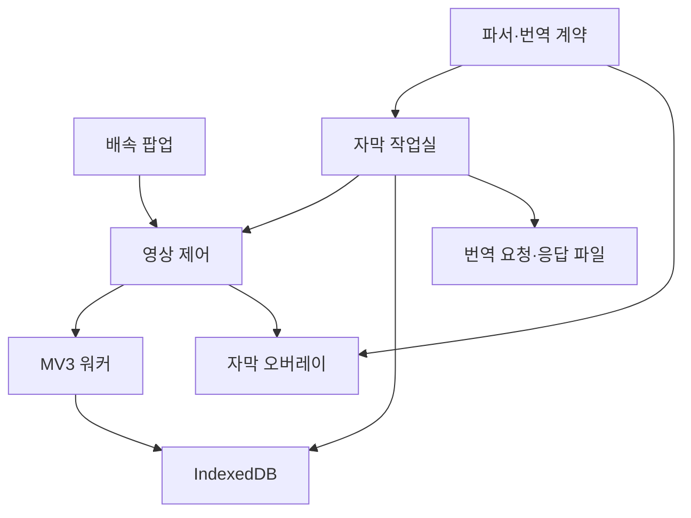

# OTTSpeed 업그레이드 설계

## 목적과 이번 결정

배속 조절 확장인 OTTSpeedController에 고품질 자막 사용·교정·번역을 통합한다. 별도 제품·저장소를 만들지 않는다. 이전 자막 프로젝트 가칭 SceneBridge의 설계는 OTTSpeed의 자막·번역 모듈 방향으로 이어간다.

첫 단계는 사용자가 선택한 파일을 이용한 수동 왕복이다. 자동 번역의 성능을 논하기 전에 **좋은 번역 파일을 넣었을 때 실제 영상에 정확하고 읽기 편하게 표시되는지**를 확인한다. 원문·한국어·번역 결과의 ID와 시간을 보존해 이후 로컬/클라우드 엔진을 같은 계약에 연결한다.

## 기존 저장소 검토

검토 기준: upstream master `29d8873ec5a0371e1414debca1398fd3630cb3a0`.

| 발견 | 변경 |
|---|---|
| 작은 순수 JavaScript MV3 확장, 빌드 도구 없음 | 기존 구조·설치 방식을 유지하고 독립 모듈 추가 |
| 제거된 video 이벤트와 참조가 남음 | 분리 시 정리, 새 영상 감지·속도 승계 |
| 입력 중 단축키가 작동 | composedPath에서 편집 요소와 IME 검사 |
| 속도 값 검증 부족 | 유한 숫자, 0.25–4 범위 검사 |
| 팝업이 다른 탭 상태 메시지를 받음 | sender extension/tab 확인 |
| worker 메모리의 탭 상태가 영속 상태처럼 취급될 수 있음 | 아이콘 Map은 캐시, 자막은 IndexedDB에 저장 |
| body에 붙인 UI의 전체화면 한계 | 플레이어 컨테이너에 재배치, video 자체 전체화면은 명시적으로 한계 표시 |
| 자동 테스트 없음 | 자막 계약·재생 상태·Chrome API 경계 회귀 테스트와 실제 브라우저 smoke harness 추가 |

## 모듈 경계

기존 속도 저장 키 `speed`는 유지한다. 자막에는 별도 IndexedDB `ottspeed-subtitles/sessions`를 사용한다. 워커가 종료돼도 파일과 설정이 보존되며 새 콘텐츠 스크립트가 저장 세션을 요청한다. 영상 교체와 비동기 복원의 경쟁은 세대 번호로 제어한다. 잘못된 수동 세션이 정상 세션을 부분 교체하지 않는다. 여러 작업실의 동시 편집은 readwrite transaction 안에서 revision 토큰을 비교해 오래된 전체 세션의 덮어쓰기를 거부한다. 저장 성공 후 영상 전달에 실패해도 저장된 새 데이터를 유지하고 재적용한다.

사이트 식별은 현재 Netflix watch ID와 YouTube video ID에 한정해 안정된 키를 사용한다. generic 페이지는 임시 문서 UUID·video 번호·소스 세대를 붙인다. 로컬 경로나 URL의 인증정보·추적 쿼리는 번역 파일에 포함하지 않는다. 사용자가 고른 자막이 실제 그 회차인지는 자동으로 보증하지 않는다.

## 번역 계약

요청은 `kind: ottspeed.translation-request`, `schemaVersion: 1`이다. `requestId`는 작업을 식별하고 `sourceHash`는 영상·모드·원문·참고 자막·출력 슬롯의 ID/시간/텍스트 전체를 SHA-256으로 묶는다. `mediaKey`는 표시 대상 영상을 구분한다.

- `source`: 영어 원문 전체 cue.
- `reference`: 교정 모드에서 선택한 한국어 cue. 새 번역에서는 null.
- `slots`: 새 번역은 영어 cue, 교정은 한국어 cue의 ID·시간·본문.
- `instructions`: 문맥·용어·인물 관계·자막 압축·데이터 취급 지시.
- `outputTemplate`: 필수 메타데이터와 모든 cue ID를 포함한 응답 틀.

응답은 `kind: ottspeed.translation-response`이며 필수 메타데이터를 그대로 돌려준다. `cues`에는 `{id, text}`를 반환한다. 누락·중복·추가 ID, 빈 대사, 다른 원문·요청·영상, 시간을 바꾸려는 결과를 거부한다. 표시용 시작/종료 시간은 신뢰한 요청 슬롯에서 복원한다. 해시는 작업 혼동을 막기 위한 식별 장치이며 AI 번역의 의미 정확성을 판정하는 점수가 아니다.

기존 A는 수정하지 않고 결과를 B에 적용한다. B는 이전 결과를 대체하므로 UI에서 먼저 내보내도록 안내한다. 교정 B는 선택한 한국어 트랙의 시간 보정을, 새 번역 B는 영어 트랙의 시간 보정을 요청 시점에 복사한다. 사용자가 실제 재생으로 확인하기 전에는 `timingVerified: false`다.

## 자막 품질의 핵심

정치 드라마의 번역 품질은 단문 번역 점수만으로 판단하지 않는다. 문맥상 지시 대상, 제도·법률 용어, 설득과 반어, 인물 간 관계, 앞뒤 농담, 화면에서 읽을 수 있는 길이를 확인한다. 보유 번역을 정답으로 간주하지 않고 잘된 표현은 유지하고 문제 구간을 교정한다.

영어와 한국어의 자막 수가 다른 자료를 번호로 결합하지 않는다. 이번 수동 요청에서는 각 언어의 전체 문맥을 제공하고 출력 슬롯을 고정한다. 향후 번역 메모리나 파인튜닝을 만들 때는 별도의 **다대다 문장 대응과 사람의 검토**가 필요하다.

## 단계별 다음 작업

| 단계 | 목표 | 완료를 판단할 근거 |
|---|---|---|
| 1 · 파일 왕복 MVP | 외부 자막·A/B·시간 보정·번역 JSON·저장 | 자동 경계 테스트, 실제 Chrome 설치, 해당 영상의 재생 확인 |
| 2 · 판본과 시간 정렬 | Netflix 기준 자막 확보, 영한 다대다 정렬, 구간별 anchor | 앞·중간·끝과 컷 전후의 시간·내용 일치 |
| 3 · 난구간 교정 | 짧은 대화 장면의 의미·용어·말투 개선, 검토 기록 | 기존 A와 교정 B의 블라인드 비교 및 오류 이유 |
| 4 · 번역 자동화 | 요청 분할·문맥 요약·용어집·재시도·부분 결과 병합 | 누락 없는 전체 커버리지, 비용·처리율 실측 |
| 5 · 로컬·클라우드 엔진 | 공통 계약에 실행 엔진 연결, 선택적 local bridge | 같은 평가 세트의 품질·메모리·지연·지속 처리율 비교 |

모델 후보와 하드웨어별 가능성은 기존 Notion 조사에 유지한다. 이 코드 버전에는 특정 모델에 대한 실행 의존성이나 품질 우열 가정이 없다. 로컬 모델은 확장 내부에 큰 모델을 직접 넣기보다 별도 로컬 실행기와 연결하는 방향으로 후속 검토한다.

## 검증 범위와 출시 전 확인

Node 모형 테스트는 문법·데이터·상태 전환 경계를 검증한다. 브라우저 레이아웃, 전체화면 실제 동작, 서비스의 DOM, Netflix 판본과 시간은 별도의 검증 대상이다. 개발 환경에 Chromium이 없으면 smoke를 통과 처리하지 않는다. [검증 절차](TESTING.md)를 따른다.

## 기술 참고

- [Chrome content scripts](https://developer.chrome.com/docs/extensions/develop/concepts/content-scripts)
- [Chrome messaging](https://developer.chrome.com/docs/extensions/develop/concepts/messaging)
- [MV3 service worker lifecycle](https://developer.chrome.com/docs/extensions/develop/concepts/service-workers/lifecycle)
- [MDN TextTrack.cues](https://developer.mozilla.org/en-US/docs/Web/API/TextTrack/cues)
- [MDN HTMLMediaElement.currentTime](https://developer.mozilla.org/en-US/docs/Web/API/HTMLMediaElement/currentTime)
- [W3C WebVTT](https://www.w3.org/TR/webvtt1/)
